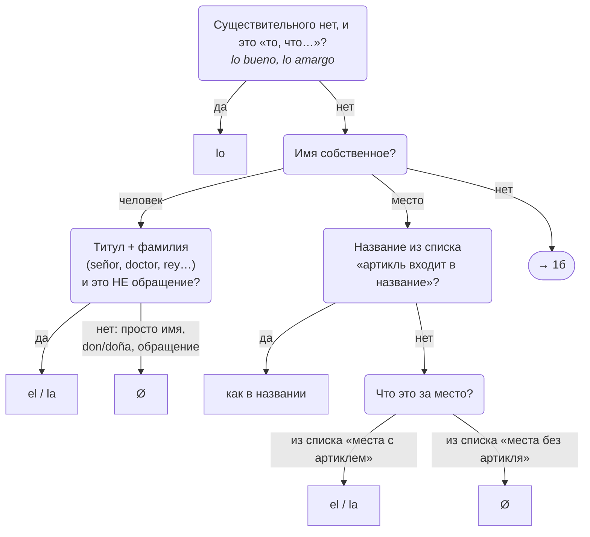
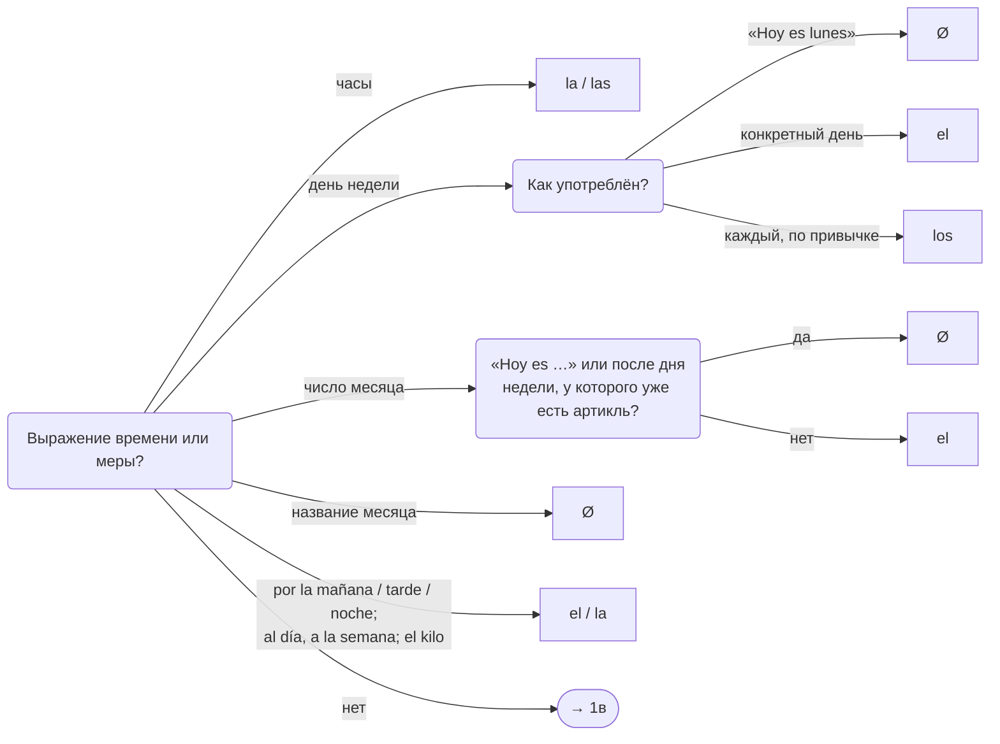
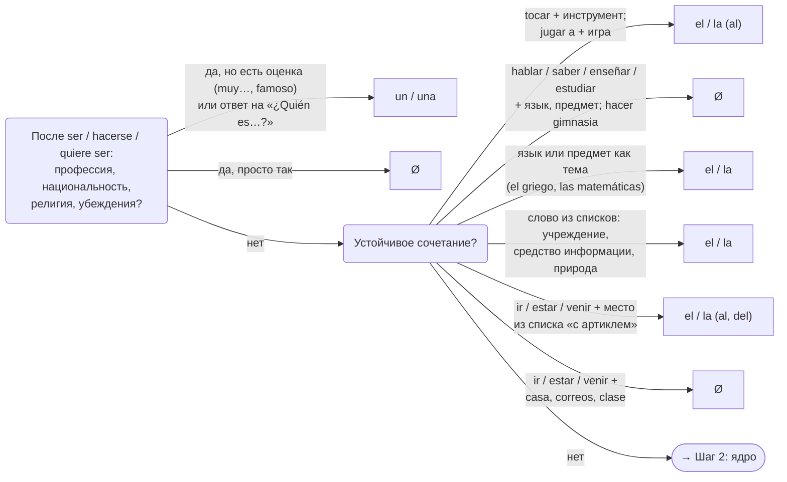
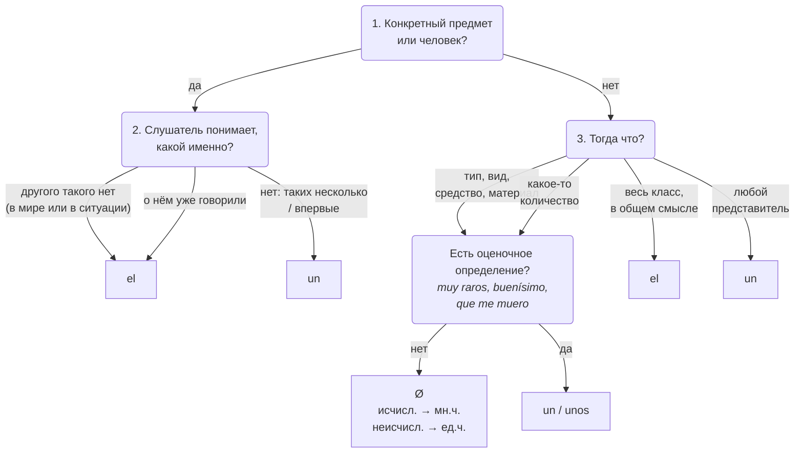

# Алгоритм выбора артикля (версия 2)

**Источники правил — только два учебника:**
- **GBE** — Gramática básica del estudiante de español (2021), гл. 5, разделы A–E;
- **GDU** — Gramática de uso del español A1-B2, юниты 4–11.

Код: [`src/algorithm-v2.mjs`](../src/algorithm-v2.mjs). Версия 1 (только GBE): [`algorithm.md`](algorithm.md).
Отчёты: [GBE](gbe-05-report-v2.md), [GDU](gdu-report-v2.md).

Порядок проверки:
1. **Особые случаи** (GDU 5, 8, 9, 10, 11) — сначала. Почти все проверяются формально: какое это слово, какой глагол, какая конструкция.
2. **Ядро** (GBE B–D, GDU 6–7) — если особого случая нет. Это вопросы v1 и одна поправка из GDU5.
3. **Форма** (GBE A, E; GDU 4, 6, 11) — род, число, el agua, al/del, uno.

## Шаг 1. Особые случаи

Вопросы идут по порядку: 1а → 1б → 1в. Если ни один не подошёл — переходите к ядру (шаг 2).

### 1а. Нет существительного? Имя собственное?

Списки к схеме 1а (GDU, юнит 8):
- **Названия, в которые входит артикль:** La Habana, El Escorial, La Haya, La Paz, Las Palmas, Los Ángeles, El Cairo, El Salvador, (la) India, (los) Estados Unidos, La Mancha, La Rioja, La Pampa. С предлогом такой артикль не сливается: a El Cairo.
- **Места с артиклем:** улицы, площади, проспекты (la calle Bolívar, la avenida de América, la plaza de España); кинотеатры, театры, отели, музеи, больницы, университеты (el Ritz, el Prado, la Autónoma); реки, озёра, моря, океаны (el Tajo, el Titicaca, el Caribe); группы островов (las Canarias); горы (los Andes); пустыни (el Sahara).
- **Места без артикля:** города, регионы, провинции, автономные сообщества, штаты, страны, континенты (Barcelona, Galicia, California, Bolivia, África); отдельные острова (Mallorca, Sicilia).

### 1б. Время и меры

### 1в. Профессия после ser; устойчивые сочетания

Списки к схеме 1в (GDU, юнит 10):
- **Учреждения:** la policía, el ejército, los bomberos.
- **Средства информации:** la radio, la televisión, el periódico, las noticias. Но если это вещь или одна новость — по ядру: una radio nueva, una televisión, una buena noticia.
- **Природа:** el mar, el campo, la playa, el cielo, la naturaleza.
- **Куда идём, где находимся (с артиклем):** al / en el hospital, cine, teatro, dentista, médico, banco, aeropuerto, lavabo, servicio, trabajo, colegio; a la / en la iglesia, universidad, cárcel, oficina.
- **Без артикля:** casa, correos, clase (voy a casa, estoy en correos).

## Шаг 2. Ядро (как в v1 + поправка GDU5)

Поправка про оценку **не** касается классифицирующих прилагательных, которые отвечают на вопрос «какой вид?»: *agua Ø mineral, café Ø descafeinado, Ø canciones tristes, Ø frutos secos*.

## Шаг 3. Форма — без изменений с v1

- Род и число: un/una/unos/unas, el/la/los/las.
- **el agua, un águila**, но **la última aula, una gran aula, las águilas**.
- a + el = **al**, de + el = **del**, но **a El Cairo** (артикль — часть имени).
- Без существительного: un → **uno**; el/la/los/las — только перед прилагательным, *de* или *que*.

## Результаты

| | v1 (только GBE) | v2 (GBE + GDU) |
|---|---|---|
| GBE, 162 пропуска | 161 (99%) | **162 (100%)** |
| GDU, 365 пропусков | 293 (80%) | **365 (100%)** |

### Насколько можно доверять 100%

На большинство вопросов шага 1 можно ответить, не думая о смысле: это имя страны? после него «Hoy es»? глагол tocar? Здесь подогнать ответ под ключ трудно. Но есть места, где я принимал решение, и о них нужно знать:

1. **`GBE5-02.1` «un hambre que me muero».** Придаточное «que me muero» я считаю оценочным определением. Правило GDU5 об этом есть, но в учебнике оно показано только на прилагательных. Это моё расширение правила.
2. **`GDU7-2.2` «El personaje principal era un detective».** По правилу GDU5 профессия после ser идёт без артикля, а в ключе un. Я разметил это как опознание («кем был главный герой»). Вариант «без артикля» упражнение и не предлагает: выбор только el/un.
3. **Аппарат или средство** (`GDU4-4.6`, `GDU7-2.6`, `GDU10-2.12`): «una radio, una televisión», когда речь о вещи. Правило в GDU10 прямое, но решать, вещь это или средство, приходится человеку.
4. **«la Casa Terror»** (`GBE5-10.4`) я отнёс к названиям заведений.

**Ядро по-прежнему зависит от трактовки в 5 местах**: el hada buena; de los muertos vivientes (хотя películas de Ø zombis); de las tumbas; por los selfis; la boda de los padres. Можно честно ответить на вопросы иначе и получить другой артикль. Эти места не закрывает ни один из двух учебников.

**Не покрыто учебниками, но совпало через ядро**: el tuyo (притяжательные), todas las noches (todos + артикль), el viejo vampiro Vlad.

### Чего ни одно упражнение не проверяет
- «a El Cairo / de El País» (артикль не сливается с предлогом) — только в теории.
- a mediodía, de madrugada (Ø) — только в теории GDU9.
- unos/unas «любой представитель» с pluralia tantum (unas gafas) — только форма.
