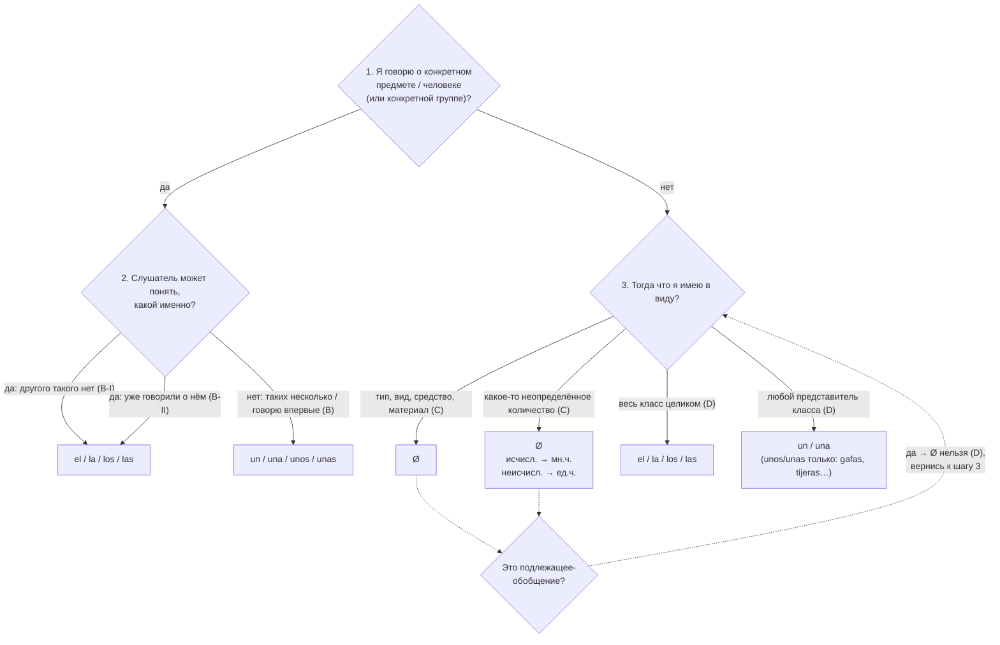
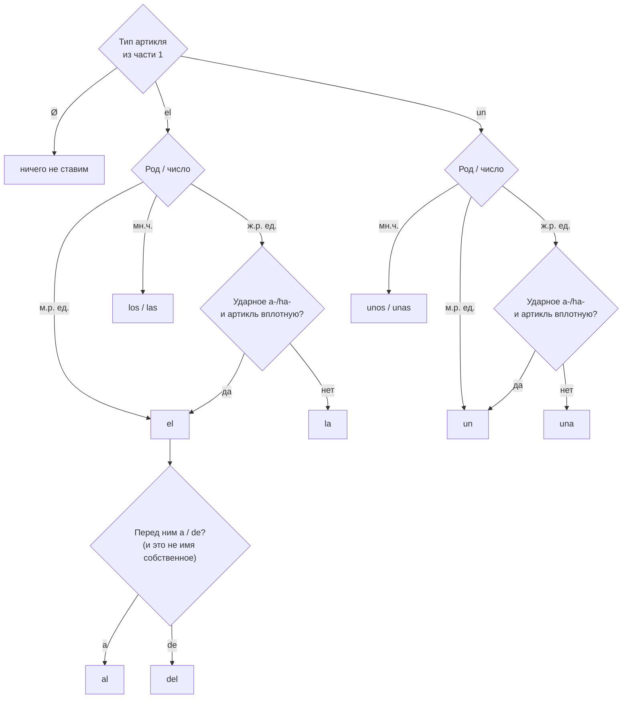

# Алгоритм выбора артикля (версия 1)

**Источник правил — только** Gramática básica del estudiante de español (2021), гл. 5, разделы A–E.
Код: [`src/algorithm.mjs`](../src/algorithm.mjs). Результат прогона по упражнениям: [`gbe-05-report.md`](gbe-05-report.md).

Алгоритм состоит из двух частей:

1. **Выбор** (разделы B, C, D): определённый (el), неопределённый (un) или без артикля (Ø).
2. **Форма** (разделы A, E): род и число, ударное a-, слияние с предлогом, опущенное существительное.

## Часть 1. Выбор

| Шаг | Вопрос | Ответ → артикль | Пример из учебника |
|---|---|---|---|
| 1→2 | Конкретный предмет, слушатель знает какой — **другого такого нет** | el | Este es Pedro, **el** hermano de María (у неё один брат) · Tengo **el** móvil roto |
| 1→2 | Конкретный, слушатель знает какой — **уже говорили** | el | **Los** amigos de Ana y yo (о них уже шла речь) · **La** carta es del banco |
| 1→2 | Конкретный, но **таких несколько / говорю впервые** | un | Necesito **un** móvil · He recibido **una** carta y **un** paquete |
| 3 | **Тип / средство / материал**, не конкретная вещь | Ø | Voy en **Ø** bicicleta · clases de **Ø** guitarra · avión de **Ø** papel · llevar **Ø** traje |
| 3 | **Неопределённое количество** | Ø (исчисл. — мн.ч., неисчисл. — ед.ч.) | ¿Venden **Ø** alfombras? · Compra **Ø** aceite y **Ø** café |
| 3 | **Весь класс** | el | **El** perro es el mejor amigo del hombre · **Los** niños siempre dicen la verdad · No me gusta **el** café |
| 3 | **Любой представитель** класса | un | **Un** flexo es una lámpara · **Un** médico tiene que saber… · **Unos** prismáticos |
| ✓ | Подлежащее-обобщение **не бывает без артикля** | — | **Un** perro necesita… (не *Perro necesita…*) · **Los** delfines son… |

## Часть 2. Форма

| Правило | Пример |
|---|---|
| Род и число | un amigo / una amiga / unos niños / unas niñas · el gato / la gata / los chicos / las chicas |
| Ж.р. ед.ч. на ударное a-/ha- **вплотную** → el/un | **el** agua, **un** águila, **el** hada, **un** hambre |
| …но если между ними слово или мн.ч. → женская форма | **la** última águila, **una** gran aula, **las** águilas, el agua **fresca** |
| a + el = al, de + el = del | Vas **al** concierto **del** viernes |
| …но не с именем собственным | Me voy **a El** Cairo · Es **de El** País |
| Без существительного: un → **uno** | ¿Me da **uno** de fresa? · Pásame un boli. **Uno** rojo vale |
| una / unos / unas без существительного — можно, когда ясно о чём речь | Cómprate **una** · ¿Te dejo **unas**? |
| el / la / los / las без существительного — **только** перед прилагательным / de + сущ. / que + придаточное | **el** negro · **la** de cristal · **las** que sirven aquí |

## Что показал прогон

**161 из 162** пропусков совпали с ключом (подробности — в [отчёте](gbe-05-report.md)).

**Не покрыто правилами учебника (1):**
- `GBE5-02.1` *Tengo **un** hambre que me muero.* По дереву голод — неисчисляемое, не конкретный предмет → Ø (как *tengo hambre*). В ключе **un**: это усилительное «un + сущ. + que…» («такой голод, что…»). В учебнике un hambre дан только как пример формы.

**Совпало, но опирается на правила других глав (4):** el tuyo (притяжательные), el doctor Jek / el viejo vampiro Vlad (титул или прилагательное + имя), todas las noches (todos + артикль).

**Где всё решает трактовка (5):** el hada buena, el órgano, la danza de **los** muertos vivientes (а «películas de **Ø** zombis»), salen de **las** tumbas, por **los** selfis. В этих местах вопросы 1–3 можно честно ответить по-разному, и дерево даст другой артикль. Это главные кандидаты на уточнение правил после второго учебника.

**Правила, которые упражнения не проверяют:** «a/de + имя собственное не сливаются» (El Cairo) — ни одного пропуска.

## Оговорка

Дерево проверяется **по моей разметке**: я сам отвечал на вопросы 1–3 для каждого пропуска (`data/gbe-05-annotations.json`, поле `why`). Значит, 99% означает, что правил учебника хватает, если правильно ответить на вопросы. Насколько легко правильно на них ответить — вопрос отдельный, и как раз о нём раздел «Где всё решает трактовка».
